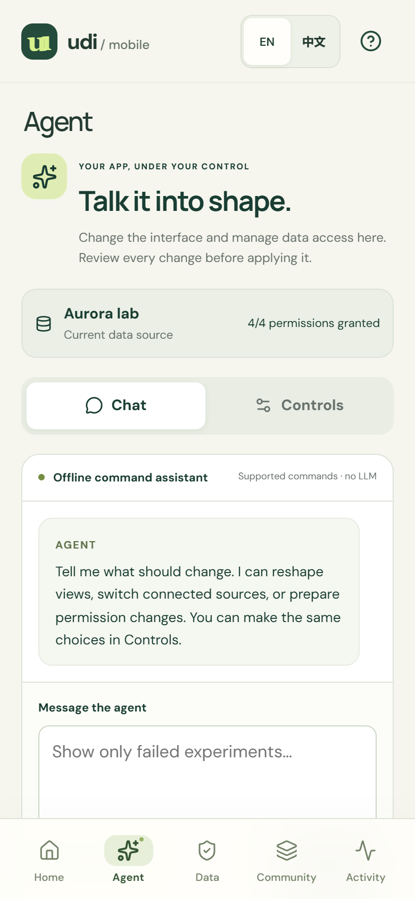
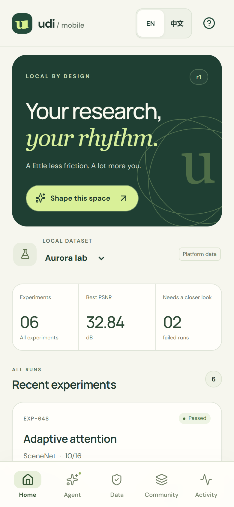
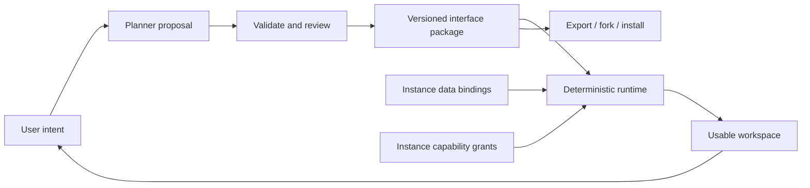

**English** | [简体中文](README.zh-CN.md)

# User-Defined Interface (UDI)

**Software, defined by you.**

Desktop: [English](https://deepbule0.github.io/UDI/?lang=en) · [简体中文](https://deepbule0.github.io/UDI/?lang=zh-CN) · Phone: [English](https://deepbule0.github.io/UDI/mobile.html?lang=en) · [简体中文](https://deepbule0.github.io/UDI/mobile.html?lang=zh-CN) · [Position paper](docs/POSITION-PAPER.md)

**Validation:** Local checks on October 17, 2026 passed 133 unit tests, 35 browser scenarios, and three production PWA checks. GitHub-hosted validation has not run successfully. [Validation evidence](docs/EVALUATION.md) · [GitHub Actions status](https://github.com/deepbule0/UDI/actions/workflows/ci.yml).

UDI proposes apps that supply **data, trusted capabilities, and a usable default interface**. Users can reshape that interface and supported interactions through **agent conversation or ordinary controls**, or adopt and adapt an interface shared by the community.

This repository demonstrates that model through a persistent research workspace. An assistant proposes a structured definition; a runtime validates it and renders it against locally bound data and explicitly granted capabilities. The broader [music-app example](docs/EXAMPLES.md) explains how the same idea could apply to an everyday app.

The unit of reuse is an **interface package**, not a copy of someone's workspace. A package describes views, logical data sources, capability requests, and actions. Each installation supplies its own data bindings, grants, and execution history.

**Status: experimental v0.3.0.** This release adds Agent chat and controls, personal data management, and public community sharing while retaining UDI package schema **0.1**. This repository contains working browser prototypes and a draft specification, not a production security system or an established standard.

**Terminology:** “user-defined interface” and the acronym **UDI** appeared in Wixon, Whiteside, Good, and Jones's CHI 1983 paper, [Building a User-Defined Interface](https://michaelgood.info/publications/usability/building-a-user-defined-interface/). This project reuses the term for the agent-mediated lifecycle described here; it does not claim naming priority.


## Agent, data, and community

Open [**Agent**](https://deepbule0.github.io/UDI/?lang=en&view=agent) to converse with the offline command assistant, or choose **Controls** for settings-style interface, source, and permission controls. Both paths prepare changes for review. Try `Use Atlas lab`, `Revoke experiment access`, or `Show only failed experiments`. The hosted assistant supports a bounded grammar; local development can use an optional model.

Open [**Data**](https://deepbule0.github.io/UDI/?lang=en&view=access) to distinguish platform-provided fictional datasets from personal research JSON imported into your browser. Personal imports start with no grants. You can review access, download data, or confirm its removal. Open [**Community**](https://deepbule0.github.io/UDI/?lang=en&view=community) to browse validated public GitHub posts and clearly labeled project starter examples, preview and install/fork a definition, or review your package and post it through GitHub. Final posting requires your own GitHub sign-in and submission; no post is created merely by opening the composer. See the [community and personal-data guide](docs/COMMUNITY.md).

 

UDI also applies within an ordinary app: a music provider could supply audio and playback capabilities plus a default interface, while users prompt an agent to redesign it or adopt a shared player interface. This research prototype demonstrates the lifecycle; it does not implement music playback or arbitrary app generation.

## Phone app demo

Open [UDI Pocket](https://deepbule0.github.io/UDI/mobile.html?lang=en) on your phone. Its cards, bottom navigation, and review sheets use the same package, validation, permissions, and confirmed-action lifecycle as the desktop app. It is an installable progressive web app (PWA); no App Store or Google Play binary is provided.

1. Browse the experiment cards in **Home**. Open **Agent**, choose **Show only failed experiments**, inspect the proposal, and select **Apply change**.
2. Use **Data** to switch platform examples, import personal research JSON, and review its grants. Adding a local note action still requires `notes.write`, an exact preview, and separate confirmation.
3. Use **Community** to discover, adapt, or post interfaces; expand **Local package tools** for file export/import. Records, grants, notes, and history stay outside the exported package.

Add it to your Home Screen using your phone browser's installation menu. The **?** button opens **About & install**. After a successful online load, wait for **Ready for offline use** before relying on the bundled demo offline. See the [phone guide](docs/MOBILE.md) for Android/iPhone installation, offline behavior, and storage limits. Devices do not sync automatically; an installed iPhone web app also has storage separate from Safari.



## Run locally

Requires Node.js **22.12+** and npm.

```sh
git clone https://github.com/deepbule0/UDI.git
cd UDI
npm ci
npm run dev
```

Open the local URL printed by Vite for the desktop app, or append `/mobile.html?lang=en` for the phone app. No API key or account is needed. The default planner is a **limited deterministic intent parser**, clearly identified in the UI. Two fictional datasets are bundled; there are no live account connections. Fonts are served with the app.

Use the **EN / 中文** language switch in the demo. Language changes affect presentation, not the package definition, data binding, or granted capabilities. The offline parser accepts both English and supported Chinese intents.

An optional [Ollama bridge](docs/AGENT.md) lets a locally installed model propose operations through the same validation and review path. Two real-model smoke cases and one browser integration case passed on the recorded local setup. These selected development examples do not establish general model quality; [failures and observations](docs/MODEL-OBSERVATIONS.md) are documented too.

## The idea, in one minute

Imagine a researcher asking:

> Show failed experiments, their recorded commits, my research library, and upcoming deadlines. Let me change this workspace as my project evolves.

The resulting workspace should remain useful after the conversation ends. Its definition should be inspectable and revisable. Another researcher should be able to reuse that definition with different data and independently chosen permissions.

UDI makes that lifecycle its central design problem:



## What is contributed here

- A [draft package contract](spec/udi.schema.json) with structural and semantic validation: bounded component types, logical sources, version checks, and capability declarations.
- A [reference runtime](src/core/runtime.ts) that resolves sources per instance and checks declared **and** granted capabilities.
- Reviewable [revision proposals](src/core/planner.ts) with exact base-state checks, atomic application, and UI undo.
- Confirmed local note creation: previews bind to an instance, revision, definition, and exact payload; execution rechecks grants and source data.
- Specification-only export/import, local forks, two independent dataset bindings, and reproducible validation and browser tests.
- Agent conversation plus settings controls, browser-local personal data import/download/removal, and a public GitHub-backed community with reviewed posting and installation.
- An English/Chinese phone PWA with card views, bottom navigation, offline app caching, and the same reviewed revision and action checks.
- A [position paper](docs/POSITION-PAPER.md), [related-work analysis](docs/RELATED-WORK.md), [threat model](SECURITY.md), and [evaluation plan](docs/EVALUATION.md).

This is an integration and lifecycle proposal. Generative UI, declarative rendering, end-user programming, and capability mediation have substantial prior art. UDI does not claim to have invented them.

## A two-minute demo

1. Select **Show only failed experiments**. Inspect the proposal; the table stays unchanged until **Apply change**.
2. Select **Atlas lab** in the instance selector. The same package now shows another project's records. **Undo** restores the previous interface, while preserving the current binding.
3. Add **related papers**. A fifth component type appears from the declared local library source.
4. Open a run to inspect its recorded commit. This is provenance by explicit ID, not causal analysis.
5. Add a **review-note action**. Grant `notes.write` in **Data & access**, then preview and confirm the local write from the workspace.
6. Open **Interface package**, export, and re-import it. Installation clears grants; approve capabilities again. Record payloads and notes are not in the package.

<details>
<summary>See a personalized workspace produced through the local-model bridge</summary>


The corresponding [review screenshot](docs/assets/udi-review.png) and [integration record](docs/bridge-smoke-results.json) show the same change before approval and after rendering.

</details>

Supported offline examples include `Show all experiments`, `Group experiments by model`, `Hide deadlines`, `Use a balanced layout`, and `Highlight regressions over 0.5 dB`. Unsupported and compound requests fail visibly instead of silently triggering a partial interpretation.

## Relationship to existing work

| Work | Its documented focus | Relationship to UDI |
| --- | --- | --- |
| [A2UI](https://github.com/a2ui-project/a2ui) | Declarative, updatable agent UI rendered through client component catalogs | A candidate rendering layer; UDI's current format is not A2UI-compatible |
| [AG-UI](https://docs.ag-ui.com/introduction) | Events, state, tools, and interaction between agent backends and frontends | A candidate transport for future proposal/review events |
| [MCP Apps](https://github.com/modelcontextprotocol/ext-apps) | Tool-provided UI resources embedded by hosts | A candidate host/integration surface |
| [json-render](https://github.com/vercel-labs/json-render) | Catalog-constrained generated interfaces and renderers | An alternative to this prototype's small renderer |

These descriptions are scope comparisons, not claims that those projects cannot support persistence, permissions, or package reuse. No interoperability adapter ships in v0.3. See [sources and boundaries](docs/RELATED-WORK.md).

## Implemented and proposed

| Implemented in v0.3 | Proposed work |
| --- | --- |
| Five component types and bounded revision operations | General workflow DSL and domain-independent component catalogs |
| Agent conversation and settings-style controls | Broad, evaluated natural-language authoring |
| Personal research JSON import, download, and confirmed removal | Live personal-account and platform connectors |
| Public GitHub community, reviewed posting, and install/fork | Moderated distribution, ratings, and signed updates |
| Local fixture bindings and permission controls | Credential-holding connector gateway and live services |
| Offline parser; optional local-model bridge | Evaluated model planners and repair strategies |
| Local persistence, export/import, fork, undo | Signed packages, migrations, and community moderation |
| Single-user state and local activity history | Multi-user concurrency and tamper-resistant audit storage |
| Installable phone PWA and cached fictional demo | Native store builds, device sync, and real mobile connectors |

The browser contains the fixture data and policy code. A person controlling the browser can bypass local checks. Export excludes structured instance fields but does **not** detect private information someone writes into a title or description. No untrusted custom code, arbitrary URLs, background automation, or irreversible external actions are supported.

## Verify and contribute

```sh
npm run check                 # types, core tests, production build
npx playwright install chromium
npm run test:e2e              # browser acceptance scenarios
npm run test:pwa              # production service-worker and offline scenarios
npm run evaluate              # bounded, deterministic conformance cases
```

For a preinstalled Edge browser on Windows, set `PLAYWRIGHT_CHANNEL=msedge` before running browser tests. The evaluation is not a model benchmark or user study.

See [architecture and specification](docs/SPECIFICATION.md), [contributing](CONTRIBUTING.md), [roadmap](docs/ROADMAP.md), and the [GitHub publication guide](docs/PUBLISHING.md). The [release announcement](docs/ANNOUNCEMENT.md) is ready to adapt for launch.

Code and original documentation are licensed under [MIT](LICENSE); bundled font licenses and other acknowledgments are in [THIRD-PARTY-NOTICES.md](THIRD-PARTY-NOTICES.md).
