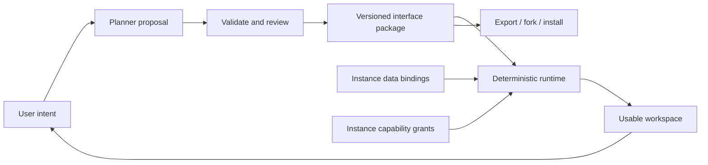

**English** | [简体中文](README.zh-CN.md)

# User-Defined Interface (UDI)

**Software, defined by you.**

Desktop: [English](https://deepbule0.github.io/UDI/?lang=en) · [简体中文](https://deepbule0.github.io/UDI/?lang=zh-CN) · Phone: [English](https://deepbule0.github.io/UDI/mobile.html?lang=en) · [简体中文](https://deepbule0.github.io/UDI/mobile.html?lang=zh-CN) · [General framework](docs/FRAMEWORK.md) · [Position paper](docs/POSITION-PAPER.md)

UDI proposes apps that supply **useful content, trusted functions, and a good default experience**, which ordinary people can reshape through **agent conversation or familiar controls**. A user can change how information is organized, which features are easy to reach, and how supported tasks fit together, then share that experience with someone else.

**UDI is a general app framework.** Music, reading, photos, travel, research, and other apps can follow the same lifecycle. Each host supplies a domain-specific contract for the content, components, and actions it supports. The [framework draft](docs/FRAMEWORK.md) defines common responsibilities, ten proposed requirements, and explicit compatibility and evidence obligations. The working research demo is one limited profile of that framework, not its full scope. These documents are a proposal for discussion, not a ratified standard.

## Illustrative use cases

| App domain | Example reusable experience | Each person supplies |
| --- | --- | --- |
| Music | An album-first player with a persistent queue and supported playlist controls | Their own music account, library, and access choices |
| Reading | A topic-grouped reading view with notes alongside the text | Their own documents, annotations, and permissions |
| Research | A workspace that prioritizes failed runs and supports a reviewed summary note | Their own research records and granted capabilities |

Users can preview a compatible shared experience, choose **Use**, and adapt it through the agent or a settings-style panel. Service integration is handled by the host.

**The reusable thing is a way of using an app:** its interface, organization of available information, preferences, and supported interactions. Provider support, account permissions, and confirmation still govern what the experience can do. See the [music-app example](docs/EXAMPLES.md) for one hypothetical application.

This repository implements a limited profile through a persistent **research workspace**. The current schema and runtime support research records; music, reading, and other domain examples remain illustrative. The prototype does not implement those service integrations or generate arbitrary apps.

**Status: experimental v0.4.0.** This release adds simple share links, visual sample previews, deliberate adoption with fresh data-access choices, and form-based local workspace creation. Agent chat and controls, advanced data tools, and public GitHub discovery remain available. Application version **0.4.0**, general framework draft **0.1**, and executable Core research schema **0.1** describe different scopes. This repository contains working browser prototypes and draft specifications, not a production security system or an established standard.

**Terminology:** “user-defined interface” and the acronym **UDI** appeared in Wixon, Whiteside, Good, and Jones's CHI 1983 paper, [Building a User-Defined Interface](https://michaelgood.info/publications/usability/building-a-user-defined-interface/). This project reuses the term for the agent-mediated lifecycle described here; it does not claim naming priority.


## Try it as an ordinary user

1. Open the [desktop](https://deepbule0.github.io/UDI/?lang=en) or [phone](https://deepbule0.github.io/UDI/mobile.html?lang=en) demo. Start using the default research workspace immediately.
2. In **Agent**, ask `Show only failed experiments`, review the change, and apply it. **Controls** offers a settings-style alternative.
3. Select **Share this interface**, give your experience a name, then **Copy link** or use your device's sharing menu. Send the link to a friend. No account, file upload, or GitHub step is needed for link sharing.
4. A recipient sees a visual preview using fictional sample records. **Use this interface** creates their local experience and opens **Data**: they choose an example workspace or **Create my workspace**, then explicitly allow reading. Their records and permissions stay their own.
5. Open **Community**, choose **Try this interface**, and preview another experience before using or adapting it.

A share link carries the supported interface definition; it does **not** list a post in the public community. Public discovery currently uses GitHub under **Advanced publishing** and requires a separate GitHub submission. Links can be forwarded, so check names and descriptions before sharing.

## Agent, data, and community

Open [**Agent**](https://deepbule0.github.io/UDI/?lang=en&view=agent) to converse with the offline command assistant, or choose **Controls** for settings-style interface, source, and permission controls. Both paths prepare changes for review. Try `Use Atlas lab`, `Revoke experiment access`, or `Show only failed experiments`. The hosted assistant supports a bounded grammar; local development can use an optional model.

Open [**Data**](https://deepbule0.github.io/UDI/?lang=en&view=access) to choose what the interface can use. Try the public fictional examples, or select **Create my workspace** and fill in a name and one experiment result. New personal workspaces start with access off. **Allow reading this workspace** approves the requested reading; writing notes remains a separate choice. These entries stay in the browser; real account connections are not implemented. JSON import, backups, and technical details remain available under **Advanced data tools**.

Open [**Community**](https://deepbule0.github.io/UDI/?lang=en&view=community) to browse validated public GitHub posts and clearly labeled project starters. Visual previews use sample data and do not read personal records. Choose **Use this interface** or **Make a copy & use**, then choose data and access yourself. To make a publicly discoverable post, expand **Advanced publishing**, review the content, and submit through your own GitHub account. Opening the composer does not create a post. See the [community and personal-data guide](docs/COMMUNITY.md).

 

The agent can revise only what a provider and runtime support. In this demo those choices concern research views, filters, grouping, visibility, data selection, permissions, and a confirmed local note action. The broader music scenario also needs a music-specific integration.

## Phone app demo

Open [UDI Pocket](https://deepbule0.github.io/UDI/mobile.html?lang=en) on your phone. Its cards, bottom navigation, and review sheets use the same package, validation, permissions, and confirmed-action lifecycle as the desktop app. It is an installable progressive web app (PWA); no App Store or Google Play binary is provided.

1. Browse the experiment cards in **Home**. Open **Agent**, choose **Show only failed experiments**, inspect the proposal, and select **Apply change**.
2. Use **Data** to choose a public example or create a local workspace through a short form, then approve its reading access. Adding a local note action still requires a separate write permission, an exact preview, and confirmation.
3. Select **Share this interface** to send a link, or use **Community** to discover and adapt an experience. **Advanced interface tools** retains file export/import; **Advanced publishing** provides public GitHub posting.

Add it to your Home Screen using your phone browser's installation menu. The **?** button opens **About & install**. After a successful online load, wait for **Ready for offline use** before relying on the bundled demo offline. See the [phone guide](docs/MOBILE.md) for Android/iPhone installation, offline behavior, and storage limits. Devices do not sync automatically; an installed iPhone web app also has storage separate from Safari.


## Run locally

Requires Node.js **22.12+** and npm.

```sh
git clone https://github.com/deepbule0/UDI.git
cd UDI
npm ci
npm run dev
```

Open the local URL printed by Vite for the desktop app, or append `/mobile.html?lang=en` for the phone app. No API key or account is needed. The default planner is a **limited deterministic intent parser**, clearly identified in the UI. Two fictional datasets are bundled; there are no live account connections. Fonts are served with the app.

Use the **EN / 中文** language switch in the demo. Language changes affect presentation, not the package definition, data binding, or granted capabilities. The offline parser accepts both English and supported Chinese intents.

An optional [Ollama bridge](docs/AGENT.md) lets a locally installed model propose operations through the same validation and review path. Two real-model smoke cases and one browser integration case passed on the recorded local setup. These selected development examples do not establish general model quality; [failures and observations](docs/MODEL-OBSERVATIONS.md) are documented too.

## The idea, in one minute

Imagine a researcher asking:

> Show failed experiments, their recorded commits, my research library, and upcoming deadlines. Let me change this workspace as my project evolves.

The resulting workspace should remain useful after the conversation ends. Another researcher should be able to preview and use that experience with their own data and independently chosen permissions. The same principle applies to the music example: reuse how the app works for a person, while each person keeps their own content and account.

Underneath that interaction is an **interface package**: a validated definition of views, logical data sources, capability requests, and supported actions. Each installation supplies its own data bindings, grants, and execution history. JSON is the current implementation format; using and sharing an experience does not require editing it.

UDI makes that lifecycle its central design problem:



## What is contributed here

- A [draft package contract](spec/udi.schema.json) with structural and semantic validation: bounded component types, logical sources, version checks, and capability declarations.
- A [reference runtime](src/core/runtime.ts) that resolves sources per instance and checks declared **and** granted capabilities.
- Reviewable [revision proposals](src/core/planner.ts) with exact base-state checks, atomic application, and UI undo.
- Confirmed local note creation: previews bind to an instance, revision, definition, and exact payload; execution rechecks grants and source data.
- Specification-only export/import, local forks, two independent dataset bindings, and reproducible validation and browser tests.
- Agent conversation plus settings controls, a local workspace creation form, visual sample previews, direct share links, and a public GitHub-backed community with reviewed posting and installation. JSON data tools remain available for advanced use.
- An English/Chinese phone PWA with card views, bottom navigation, offline app caching, and the same reviewed revision and action checks.
- A [position paper](docs/POSITION-PAPER.md), [related-work analysis](docs/RELATED-WORK.md), [threat model](SECURITY.md), and [evaluation plan](docs/EVALUATION.md).
- A general [framework draft](docs/FRAMEWORK.md) separating reusable experience, provider contract, and personal instance, with proposed requirements and bounded compatibility claims across app domains.

This is an integration and lifecycle proposal. Generative UI, declarative rendering, end-user programming, and capability mediation have substantial prior art. UDI does not claim to have invented them.

## A two-minute demo

1. Select **Show only failed experiments**. Inspect the proposal; the table stays unchanged until **Apply change**.
2. Select **Atlas lab** in the instance selector. The same package now shows another project's records. **Undo** restores the previous interface, while preserving the current binding.
3. Add **related papers**. A fifth component type appears from the declared local library source.
4. Open a run to inspect its recorded commit. This is provenance by explicit ID, not causal analysis.
5. Add a **review-note action**. Grant `notes.write` in **Data & access**, then preview and confirm the local write from the workspace.
6. Select **Share this interface**, then **Copy link**. Open it in another browser context, preview it, and choose **Use this interface**. Select a workspace and approve its reading access. File export/import is also available under **Advanced tools** on desktop or **Advanced interface tools** on phone. Installation clears grants; record payloads and notes do not travel with the interface.

<details>
<summary>See a personalized workspace produced through the local-model bridge</summary>


The corresponding [review screenshot](docs/assets/udi-review.png) and [integration record](docs/bridge-smoke-results.json) show the same change before approval and after rendering.

</details>

Supported offline examples include `Show all experiments`, `Group experiments by model`, `Hide deadlines`, `Use a balanced layout`, and `Highlight regressions over 0.5 dB`. Unsupported and compound requests fail visibly instead of silently triggering a partial interpretation.

## Relationship to existing work

| Work | Its documented focus | Relationship to UDI |
| --- | --- | --- |
| [A2UI](https://github.com/a2ui-project/a2ui) | Declarative, updatable agent UI rendered through client component catalogs | A candidate rendering layer; UDI's current format is not A2UI-compatible |
| [AG-UI](https://docs.ag-ui.com/introduction) | Events, state, tools, and interaction between agent backends and frontends | A candidate transport for future proposal/review events |
| [MCP Apps](https://github.com/modelcontextprotocol/ext-apps) | Tool-provided UI resources embedded by hosts | A candidate host/integration surface |
| [json-render](https://github.com/vercel-labs/json-render) | Catalog-constrained generated interfaces and renderers | An alternative to this prototype's small renderer |

These descriptions are scope comparisons, not claims that those projects cannot support persistence, permissions, or package reuse. No interoperability adapter ships in v0.4. See [sources and boundaries](docs/RELATED-WORK.md).

## Implemented and proposed

| Implemented in v0.4 | Proposed work |
| --- | --- |
| Five component types and bounded revision operations | General workflow DSL and domain-independent component catalogs |
| Agent conversation and settings-style controls | Broad, evaluated natural-language authoring |
| Form-based local workspace creation, optional JSON tools, and confirmed deletion | Live personal-account and platform connectors |
| Direct share links, visual previews, and use with independently chosen data | Larger experiences, richer preferences, and broader supported workflows |
| Public GitHub community, reviewed advanced posting, and reuse | Moderated distribution, ratings, and signed updates |
| Local fixture bindings and permission controls | Credential-holding connector gateway and live services |
| Offline parser; optional local-model bridge | Evaluated model planners and repair strategies |
| Local persistence, export/import, fork, undo | Signed packages, migrations, and community moderation |
| Single-user state and local activity history | Multi-user concurrency and tamper-resistant audit storage |
| Installable phone PWA and cached fictional demo | Native store builds, device sync, and real mobile connectors |

The browser contains the fixture data and policy code. A person controlling the browser can bypass local checks. Export excludes structured instance fields but does **not** detect private information someone writes into a title or description. No untrusted custom code, arbitrary URLs, background automation, or irreversible external actions are supported.

## Verify and contribute

**Validation:** Local checks on October 17, 2026 passed 150 unit tests, 46 browser scenarios, three production PWA checks, and deterministic conformance cases covering 16 intents and three invariants. GitHub-hosted validation has not run successfully. [Validation evidence](docs/EVALUATION.md) · [GitHub Actions status](https://github.com/deepbule0/UDI/actions/workflows/ci.yml).

```sh
npm run check                 # types, core tests, production build
npx playwright install chromium
npm run test:e2e              # browser acceptance scenarios
npm run test:pwa              # production service-worker and offline scenarios
npm run evaluate              # bounded, deterministic conformance cases
```

For a preinstalled Edge browser on Windows, set `PLAYWRIGHT_CHANNEL=msedge` before running browser tests. The evaluation is not a model benchmark or user study.

See the [general framework](docs/FRAMEWORK.md), [Core research architecture and specification](docs/SPECIFICATION.md), [contributing](CONTRIBUTING.md), [roadmap](docs/ROADMAP.md), and the [GitHub publication guide](docs/PUBLISHING.md). The [release announcement](docs/ANNOUNCEMENT.md) is ready to adapt for launch.

Code and original documentation are licensed under [MIT](LICENSE); bundled font licenses and other acknowledgments are in [THIRD-PARTY-NOTICES.md](THIRD-PARTY-NOTICES.md).
