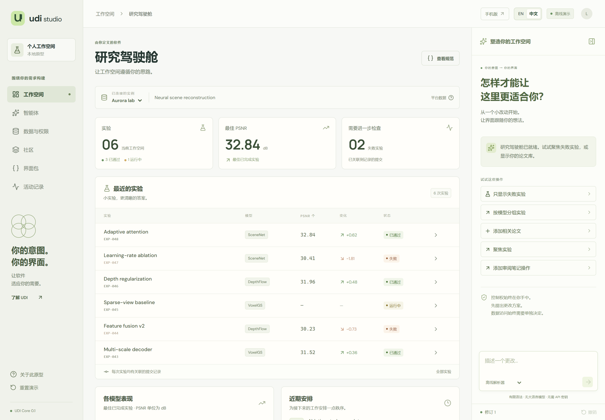
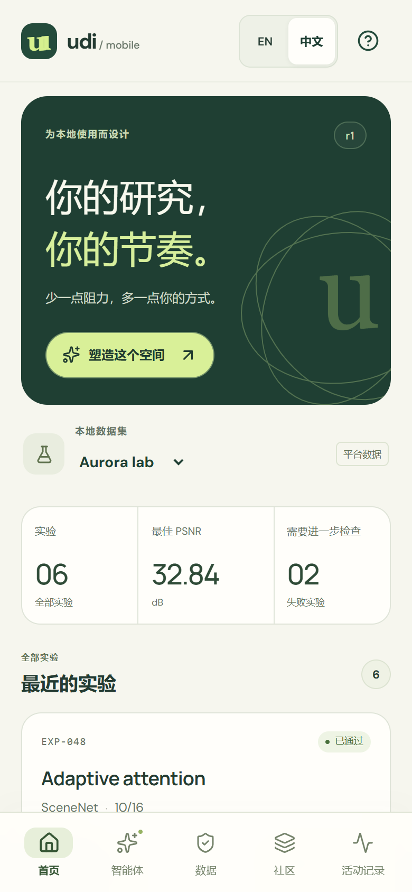
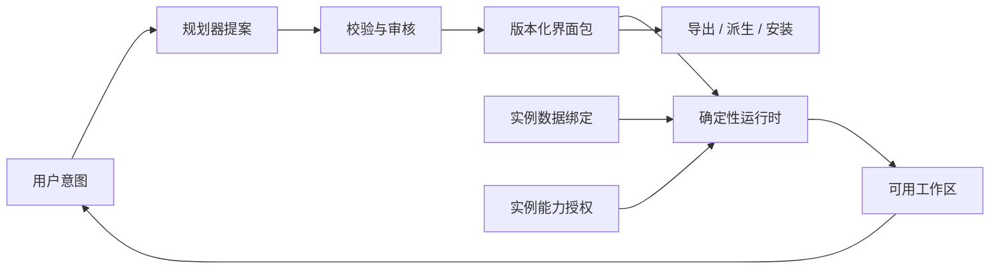
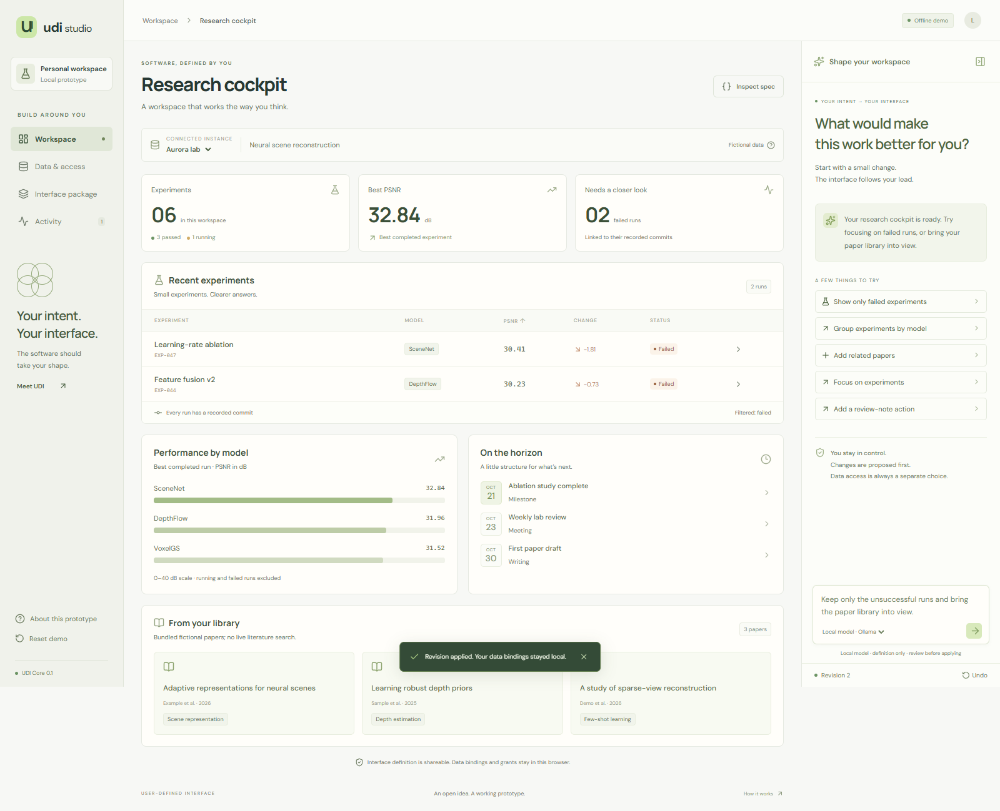

[English](README.md) | **简体中文**

# 用户定义界面（User-Defined Interface，UDI）

**由你定义的软件。**

桌面：[简体中文](https://deepbule0.github.io/UDI/?lang=zh-CN) · [English](https://deepbule0.github.io/UDI/?lang=en) · 手机：[简体中文](https://deepbule0.github.io/UDI/mobile.html?lang=zh-CN) · [English](https://deepbule0.github.io/UDI/mobile.html?lang=en) · [阅读中文提案](docs/zh-CN/POSITION-PAPER.md)

**验证状态：** 2026 年 10 月 17 日的本地检查通过了 133 项单元测试、35 个浏览器场景和 3 项生产 PWA 检查。GitHub 托管的验证尚未成功运行。[验证证据](docs/zh-CN/EVALUATION.md) · [GitHub Actions 状态](https://github.com/deepbule0/UDI/actions/workflows/ci.yml)。

UDI 是一项面向持久化个人软件的设计提案及参考原型。用户描述自己希望如何工作；智能体提出结构化的界面定义；运行时对定义进行校验，并结合当前实例绑定的数据和明确授予的能力，将其渲染为可用界面。

复用的单位是**界面包（interface package）**，而不是某个人工作区的副本。界面包描述视图、逻辑数据源、能力请求和操作；每次安装则分别提供自己的数据绑定、授权和执行历史。

**状态：实验性版本 v0.3.0。** 此版本新增智能体对话与控制面板、个人数据管理和公开社区分享，继续使用 **0.1** 版 UDI 界面包格式。本仓库包含可运行的浏览器原型和规范草案，尚不构成生产级安全系统或已确立的标准。

**术语说明：** “user-defined interface”这一表述及其缩写 **UDI** 已出现于 Wixon、Whiteside、Good 和 Jones 在 CHI 1983 发表的论文 [Building a User-Defined Interface](https://michaelgood.info/publications/usability/building-a-user-defined-interface/) 中。本项目沿用这一术语，描述本文提出的、由智能体参与的界面生命周期，不主张对名称的首创权。



## 智能体、数据与社区

打开**智能体**与离线指令助手对话，或选择**控制面板**，通过设置式控件管理界面、数据源和权限。两条路径都先生成待审核的更改。可尝试 `切换到 Atlas lab`、`撤销实验访问权限` 或 `只显示失败实验`。托管助手仅支持有限语法，本地开发可选用模型。

打开**数据**，区分平台提供的虚构数据集与保存在此浏览器中的个人研究 JSON。个人导入初始不授予任何权限，可以审阅访问、下载数据或确认删除。打开**社区**，浏览通过校验的公开 GitHub 帖子和明确标识的项目示例，预览并安装或派生界面定义，或审阅自己的界面包并通过 GitHub 发布。最终发布需要使用自己的 GitHub 账号登录并提交；仅打开编辑器不会创建帖子。详见[社区与个人数据指南](docs/zh-CN/COMMUNITY.md)。

UDI 也适用于普通应用内部：例如音乐平台提供音频、播放能力和默认界面，用户通过智能体提示词重新设计界面，或采用社区分享的播放器界面。当前研究原型演示的是这套生命周期，尚未实现音乐播放或任意应用生成。

## 手机应用演示

用手机打开 [UDI Pocket](https://deepbule0.github.io/UDI/mobile.html?lang=zh-CN)。它采用卡片、底部导航和审核面板，与桌面应用共享界面包、校验、权限及操作确认的生命周期。这是可安装的渐进式网页应用（PWA），未提供 App Store 或 Google Play 安装包。

1. 在**首页**浏览实验卡片。打开**智能体**，选择**只显示失败实验**，检查提案后点击**应用更改**。
2. 在**数据**中切换平台示例、导入个人研究 JSON 并检查授权。添加本地笔记操作后，仍需授予 `notes.write`，预览确切内容并单独确认。
3. 在**社区**中发现、改造或发布界面；展开**本地界面包工具**可进行文件导出或导入。导出的界面包不包含记录、授权、笔记或历史。

通过手机浏览器的安装菜单添加到主屏幕。顶部 **?** 按钮可打开**关于与安装**。首次成功联网加载后，请等待**可离线使用**提示，再依赖内置演示的离线功能。Android/iPhone 安装、离线行为和存储限制见[手机使用指南](docs/zh-CN/MOBILE.md)。不同设备不会自动同步；iPhone 主屏幕网页应用与 Safari 的存储也相互独立。



## 本地运行

需要 Node.js **22.12+** 和 npm。

```sh
git clone https://github.com/deepbule0/UDI.git
cd UDI
npm ci
npm run dev
```

打开 Vite 输出的本地网址即可进入桌面应用；在网址后添加 `/mobile.html?lang=zh-CN` 可进入手机应用。无需 API 密钥或账号。默认规划器是一个**能力有限的确定性意图解析器**，界面中会明确标示。应用内置两组虚构数据，没有连接真实账号。字体随应用一起提供。

演示中可通过 **EN / 中文** 切换语言。语言切换只影响显示，不修改界面包定义、数据绑定或已授予的能力。离线解析器同时接受英语和支持范围内的中文指令。

可选的 [Ollama 桥接服务](docs/zh-CN/AGENT.md)允许本地安装的模型提出操作，并沿用同一套校验与审核流程。在记录的本地环境中，两个真实模型冒烟测试用例和一个浏览器集成用例已通过。这些经过选择的开发示例不能证明模型的整体质量；相关[失败与观察记录](docs/zh-CN/MODEL-OBSERVATIONS.md)也已公开。

## 一分钟理解这个想法

设想一位研究者提出：

> 显示失败的实验、实验记录中的提交、我的研究文献库和即将到来的截止日期。随着项目推进，让我可以持续调整这个工作区。

生成的工作区应当在对话结束后继续可用。它的定义应当可以检查和修改。另一位研究者应当能复用这份定义，同时使用不同的数据，并独立选择授予哪些权限。

UDI 将这一生命周期作为核心设计问题：



## 本项目的贡献

- 一份包含结构校验和语义校验的[界面包契约草案](spec/udi.schema.json)：限定组件类型、声明逻辑数据源、检查版本并声明能力。
- 一个[参考运行时](src/core/runtime.ts)：按实例解析数据源，同时检查**已声明**和**已授予**的能力。
- 可审核的[修订提案](src/core/planner.ts)：精确检查基础状态，以原子方式应用变更，并支持在界面中撤销。
- 经过确认的本地笔记创建：预览与实例、修订版本、定义和确切载荷绑定；执行时再次检查授权与源数据。
- 仅包含定义的导出与导入、本地派生副本、两组相互独立的数据集绑定，以及可复现的校验和浏览器测试。
- 智能体对话与设置式控件、浏览器本地的个人数据导入/下载/删除，以及基于公开 GitHub 帖子的社区和审核后发布、安装流程。
- 中英双语手机 PWA：卡片视图、底部导航、离线应用缓存，以及同一套修订审核和操作检查。
- 一篇[立场论文](docs/zh-CN/POSITION-PAPER.md)、[相关工作分析](docs/zh-CN/RELATED-WORK.md)、[威胁模型](docs/zh-CN/SECURITY.md)和[评估计划](docs/zh-CN/EVALUATION.md)。

这是一项关于系统整合与生命周期的提案。生成式界面、声明式渲染、终端用户编程和能力管控都已有大量先行工作。UDI 不主张发明了这些技术。

## 两分钟演示

1. 选择 **Show only failed experiments（仅显示失败的实验）**。检查提案；在点击 **Apply change（应用变更）**前，表格保持不变。
2. 在实例选择器中选择 **Atlas lab**。同一个界面包会显示另一个项目的记录。**Undo（撤销）**会恢复之前的界面定义，同时保留当前的数据绑定。
3. 添加 **related papers（相关论文）**。第五种组件类型会从已声明的本地文献库数据源中出现。
4. 打开一次实验运行，查看其记录的提交。这是通过显式 ID 提供的来源追溯，不是因果分析。
5. 添加 **review-note action（审阅笔记操作）**。在 **Data & access（数据与访问权限）**中授予 `notes.write`，然后在工作区预览并确认本地写入。
6. 打开 **Interface package（界面包）**，将其导出后重新导入。安装会清除授权，需要重新批准能力。界面包不包含记录载荷和笔记。

<details>
<summary>查看通过本地模型桥接服务生成的个性化工作区</summary>



对应的[审核截图](docs/assets/udi-review.png)和[集成记录](docs/bridge-smoke-results.json)展示了同一项变更在批准前和渲染后的状态。

</details>

离线解析器支持的示例包括 `Show all experiments`（显示全部实验）、`Group experiments by model`（按模型分组实验）、`Hide deadlines`（隐藏截止日期）、`Use a balanced layout`（使用均衡布局）和 `Highlight regressions over 0.5 dB`（突出显示超过 0.5 dB 的性能退化）。不支持的请求和复合请求会明确失败，不会悄悄只执行其中一部分。这里列出的中文用于说明示例含义；离线解析器的实际支持范围以实现和界面提示为准。

## 与现有工作的关系

| 工作 | 其文档说明的重点 | 与 UDI 的关系 |
| --- | --- | --- |
| [A2UI](https://github.com/a2ui-project/a2ui) | 通过客户端组件目录渲染可更新的声明式智能体界面 | 可作为候选渲染层；UDI 当前的格式并不兼容 A2UI |
| [AG-UI](https://docs.ag-ui.com/introduction) | 智能体后端与前端之间的事件、状态、工具和交互 | 可用于未来提案与审核事件的传输 |
| [MCP Apps](https://github.com/modelcontextprotocol/ext-apps) | 由工具提供、嵌入宿主的界面资源 | 可作为候选宿主或集成入口 |
| [json-render](https://github.com/vercel-labs/json-render) | 基于组件目录约束的界面生成与渲染器 | 可替代本原型的小型渲染器 |

以上比较描述各项目的侧重点，不意味着这些项目无法支持持久化、权限或界面包复用。v0.3 没有提供互操作适配器。详见[来源与边界](docs/zh-CN/RELATED-WORK.md)。

## 已实现与拟开展的工作

| v0.3 已实现 | 拟开展的工作 |
| --- | --- |
| 五种组件类型和范围受限的修订操作 | 通用工作流 DSL 与不依赖特定领域的组件目录 |
| 本地预置数据绑定和权限控制 | 持有凭证的连接器网关与真实服务 |
| 离线解析器；可选的本地模型桥接服务 | 经过评估的模型规划器及修复策略 |
| 本地持久化、导出与导入、派生副本、撤销 | 签名界面包、迁移与社区治理 |
| 单用户状态与本地活动历史 | 多用户并发与防篡改审计存储 |
| 可安装的手机 PWA 和缓存的虚构演示 | 原生应用商店版本、设备同步及真实手机连接器 |

预置数据和策略代码都位于浏览器中。控制浏览器的人可以绕过本地检查。导出会排除结构化的实例字段，但**不会**检测被写入标题或描述的私人信息。本原型不支持不受信任的自定义代码、任意 URL、后台自动化或不可逆的外部操作。

## 验证与参与

```sh
npm run check                 # 类型检查、核心测试、生产构建
npx playwright install chromium
npm run test:e2e              # 浏览器验收场景
npm run test:pwa              # 生产 Service Worker 与离线场景
npm run evaluate              # 范围受限的确定性符合性用例
```

如果使用 Windows 上已安装的 Edge 浏览器，请在运行浏览器测试前设置 `PLAYWRIGHT_CHANNEL=msedge`。这些评估不是模型基准测试或用户研究。

参见[架构与规范](docs/zh-CN/SPECIFICATION.md)、[贡献指南](docs/zh-CN/CONTRIBUTING.md)、[路线图](docs/zh-CN/ROADMAP.md)和 [GitHub 发布指南](docs/zh-CN/PUBLISHING.md)。[发布公告](docs/zh-CN/ANNOUNCEMENT.md)可作为发布时的文案基础。

代码和原创文档采用 [MIT 许可证](LICENSE)；内置字体的许可证及其他致谢见 [THIRD-PARTY-NOTICES.md](docs/zh-CN/THIRD-PARTY-NOTICES.md)。
