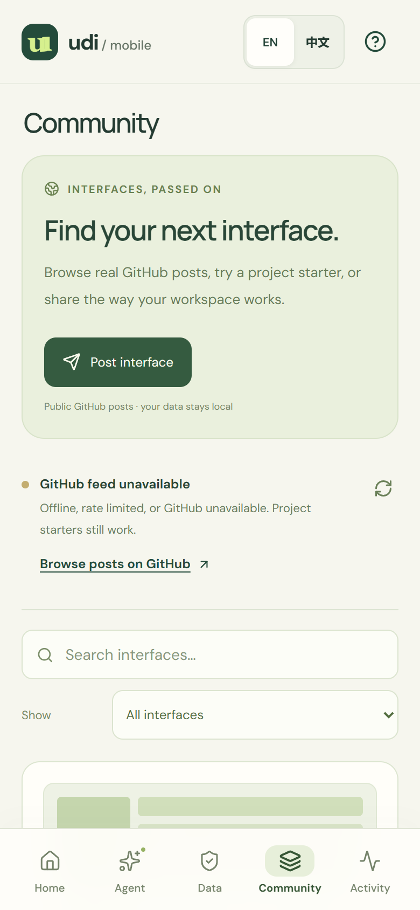

# Interface community and personal data

**English** | [简体中文](zh-CN/COMMUNITY.md)

[Open the demo](https://deepbule0.github.io/UDI/?lang=en) · [Phone demo](https://deepbule0.github.io/UDI/mobile.html?lang=en) · [Public GitHub posts](https://github.com/deepbule0/UDI/issues?q=is%3Aissue%20is%3Aopen%20label%3Audi-interface)

UDI separates a reusable interface definition from the data and permissions of each person's instance. The **Community**, **Agent**, and **Data** areas make that separation usable: copy a definition, connect your own records, and change the result through chat or ordinary controls.

## Find and adopt an interface

1. Open **Community** on the desktop or phone demo. Search by title, author, or description; filter by **Community posts** or **Project starters**.
2. Select **Preview & install**. Check the visible views, requested capabilities, and complete package JSON. Card thumbnails are illustrative layout motifs; the package details describe the actual interface.
3. Acknowledge the installation scope, then choose **Install interface** or **Fork & install**. A fork receives a local package identity and title that you can change further.
4. Installation replaces the current definition and clears grants for **all** local datasets. Your records and local notes remain. Review the current source's access in **Data**, or prepare permission changes in **Agent**.
5. Open **Agent → Chat** to request another supported change, or use **Controls** for layout, filters, panel visibility, connected source, and permissions. Both Agent modes prepare a proposal before **Apply change**. Adding a write action requests a capability; it does not grant it or perform the write. Exact note creation still needs separate confirmation.

The real feed reads up to **50 open GitHub Issues** carrying the `udi-interface` label from this repository. Only marked posts with one schema-valid JSON package appear. GitHub identifies each public author. Pull requests, invalid packages, unsupported fields, and executable components are rejected. This is a GitHub-backed prototype, with no ratings, follower graph, private marketplace, or compatibility with arbitrary app definitions.

Built-in cards are explicitly **UDI project starters**, authored by the project. They are available for trying the lifecycle and are not evidence of other users' posts. A successful empty feed says that no valid interface posts are available. On a failed fetch, the app labels cached results or says the feed is unavailable; it never invents activity. GitHub rate limits and network failures can affect freshness. The feed's public cache stores validated public definitions, not private instance state.

## Post your interface

1. In **Community**, select **Post interface**. Edit the post title and introduction.
2. Review the **complete package JSON**. Records, bindings, grants, local notes, conversation, and activity are excluded structurally. Titles, descriptions, and other free text may still contain private details that you entered; review them yourself.
3. Confirm that the post will be public, then select **Open GitHub composer**. This opens the repository's real issue template. Opening this page does **not** publish anything.
4. Sign in to GitHub if requested, review the issue body, and submit there. Long definitions use **Copy post body** or manual copy because a reliable composer URL cannot hold the entire package; paste that body into the GitHub issue description before submitting.
5. Return to Community and select **Refresh community**. The post appears after it is publicly fetched and passes validation. If it is absent, check that it is an open issue with the `udi-interface` label, contains `<!-- udi-interface:0.1 -->`, and has exactly one fenced `json` block containing a supported package.

The app does not ask for a GitHub token or store one. Browsing uses public unauthenticated reads; GitHub handles authentication and the final public write. Public sharing exposes the post and GitHub identity. To edit or withdraw a post, use GitHub; a cached copy may remain visible until the next successful refresh. A label is a discovery filter, not a security endorsement.

## Use your own data

**Data** distinguishes **Platform sample** datasets from **Personal · browser only** sources. Aurora and Atlas contain bundled fictional records, not live platform-account data. Personal JSON import lets the same research interface operate on records you provide.

Choose **Download example JSON**, replace the sample content, then **Import personal data** and choose a file or paste JSON. The normalized shape has the exact top-level fields `id`, `name`, `project`, `description`, `experiments`, `commits`, `deadlines`, and `papers`. Each experiment refers to an existing commit by `commitId`. Downloaded examples show all required record fields. This is a research-data adapter; audio, streaming music, arbitrary files, live APIs, credentials, URLs, and executable content are unsupported.

Imports enforce **500 KiB per file**, **200 records per collection**, and **5 personal datasets**, plus field lengths, unique IDs, valid calendar dates, finite numbers, supported statuses, and matching commit references. Every import gets a fresh `personal-*` ID, so it cannot overwrite Aurora, Atlas, or another imported dataset. It is connected with empty grants; inspect its access before the interface can read it or create a note. Bindings and grants belong to each local instance. Switching datasets preserves their separate permissions and notes.

Use **Download data** on a personal source for a JSON copy of its records. That download excludes grants and notes. **Remove data** requires a confirmation explaining that its records, notes, and grants will be permanently removed from this browser; deleting the active source selects Aurora. Interface packages do not serve as a backup for personal records. Data is not uploaded or synchronized; browser clearing or storage pressure can remove local data. Use downloaded copies to keep important records.

The hosted Agent supports a bounded English/Chinese command grammar, not a general-purpose language model. For example, **Use Atlas lab**, **Revoke experiment access**, and **Grant experiment access** propose instance changes; **Show only failed experiments** proposes a definition change. Imported source names can also be used in a binding command. The Agent cannot autonomously publish or delete data. See [the Agent guide](AGENT.md), [phone guide](MOBILE.md), [package specification](SPECIFICATION.md), and [security model](../SECURITY.md).
