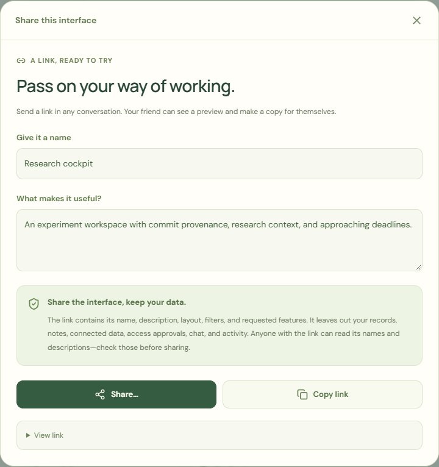

# Interface community and personal data

**English** | [简体中文](zh-CN/COMMUNITY.md)

[Open the demo](https://deepbule0.github.io/UDI/?lang=en) · [Phone demo](https://deepbule0.github.io/UDI/mobile.html?lang=en) · [Public GitHub posts](https://github.com/deepbule0/UDI/issues?q=is%3Aissue%20is%3Aopen%20label%3Audi-interface)

UDI lets people share a reusable way of using an app: its presentation, supported behavior, and organization of data. The person receiving it supplies their own workspace and permissions. Ordinary use follows **Try → Use → Personalize → Share**, without preparing an API request, uploading a definition file, or reading JSON. The [general UDI framework](FRAMEWORK.md) applies across app categories; this demo implements a narrower research-workspace profile, UDI Core 0.1.

## Share a link with anyone

1. On your workspace, select **Share this interface**, or choose **Share my interface** in Community.
2. Give it a name and a short description. Review these public words and the plain-language privacy summary.
3. Choose **Share…** if the browser offers native sharing, or **Copy link** and paste it into a conversation. No UDI account, GitHub account, file, or upload is needed.
4. The recipient opens a visual preview using bundled fictional sample data. Merely opening the link does not change their interface or permissions.
5. **Use this interface** makes a local copy, replaces the current definition, and opens Data. All existing local grants are cleared; the recipient chooses their own workspace and explicitly allows the reading it needs. Their records and notes remain local.

The link carries the validated definition, including supported filters, organization, action definitions, and capability requests. It excludes records, bindings, credentials, grants, notes, chat, and activity. Anyone receiving it can read its names and descriptions; review free text before sharing. A link is a copy, not a live subscription to later edits. It does **not** add a public Community listing. There is no hosted short-link service or link revocation; deleting a post cannot recall a link already sent. Long links may be rejected or truncated by a messaging app. File transfer remains available in advanced tools.

## Find and adopt an interface

1. Open **Community** on the desktop or phone demo. Search by title, author, or description; filter by **Community posts** or **Project starters**.
2. Select **Try this interface**. The card and full preview render the actual definition against public sample data. Inspect the supported views and the plain-language list of data it can use; **Technical details** is optional.
3. Choose **Use this interface** or **Make a copy & use**. The latter also creates a new local package identity and title that you can change further.
4. Installation replaces the current definition and clears grants for **all** local datasets. Your records and local notes remain. Review the current source's access in **Data**, or prepare permission changes in **Agent**.
5. Open **Agent → Chat** to request another supported change, or use **Controls** for layout, filters, panel visibility, connected source, and permissions. Both Agent modes prepare a proposal before **Apply change**. Adding a write action requests a capability; it does not grant it or perform the write. Exact note creation still needs separate confirmation.

The real feed reads up to **50 open GitHub Issues** carrying the `udi-interface` label from this repository. Only marked posts with one schema-valid JSON package appear. GitHub identifies each public author. Pull requests, invalid packages, unsupported fields, and executable components are rejected. This is a GitHub-backed prototype, with no ratings, follower graph, private marketplace, or compatibility with arbitrary app definitions.

Built-in cards are explicitly **UDI project starters**, authored by the project. They are available for trying the lifecycle and are not evidence of other users' posts. A successful empty feed says that no valid interface posts are available. On a failed fetch, the app labels cached results or says the feed is unavailable; it never invents activity. GitHub rate limits and network failures can affect freshness. The feed's public cache stores validated public definitions, not private instance state.

## List your interface publicly: advanced publishing

1. In **Community**, expand **Advanced publishing** and select **Publish to public community**. Edit the post title and introduction. This optional GitHub workflow is separate from ordinary link sharing.
2. Review the **complete package JSON**. Records, bindings, grants, local notes, conversation, and activity are excluded structurally. Titles, descriptions, and other free text may still contain private details that you entered; review them yourself.
3. Confirm that the post will be public, then select **Open GitHub composer**. This opens the repository's real issue template. Opening this page does **not** publish anything.
4. Sign in to GitHub if requested, review the issue body, and submit there. Long definitions use **Copy post body** or manual copy because a reliable composer URL cannot hold the entire package; paste that body into the GitHub issue description before submitting.
5. Return to Community and select **Refresh community**. The post appears after it is publicly fetched and passes validation. If it is absent, check that it is an open issue with the `udi-interface` label, contains `<!-- udi-interface:0.1 -->`, and has exactly one fenced `json` block containing a supported package.

The app does not ask for a GitHub token or store one. Browsing uses public unauthenticated reads; GitHub handles authentication and the final public write. Public sharing exposes the post and GitHub identity. To edit or withdraw a post, use GitHub; a cached copy may remain visible until the next successful refresh. A label is a discovery filter, not a security endorsement.

## Use your own data

In **Data**, use **Create my workspace** to enter a workspace name and one experiment's name, model, status, and score. Select **Create workspace**, then **Allow reading this workspace** or individual access choices. The form prepares the supported research records for you; no JSON file is needed. Note creation remains a separate permission and exact-action confirmation. This first-entry form is not a complete research-record editor.

**Try an example** offers Aurora and Atlas, containing bundled fictional records. **My workspaces** contains entries saved only in this browser. These are not connections to live provider accounts. The same interface can use either source with separate grants and notes.

For existing normalized records, expand **Advanced data tools**. The file import and backup options are developer and migration tools, not the ordinary sharing flow.

Choose **Download example JSON**, replace the sample content, then **Import personal data** and choose a file or paste JSON. The normalized shape has the exact top-level fields `id`, `name`, `project`, `description`, `experiments`, `commits`, `deadlines`, and `papers`. Each experiment refers to an existing commit by `commitId`. Downloaded examples show all required record fields. This implemented research-data adapter does not support arbitrary app data, audio, streaming music, live APIs, credentials, URLs, or executable content. Music is an illustrative application; no music-service integration is implemented.

Imports enforce **500 KiB per file**, **200 records per collection**, and **5 personal datasets**, plus field lengths, unique IDs, valid calendar dates, finite numbers, supported statuses, and matching commit references. Every import gets a fresh `personal-*` ID, so it cannot overwrite Aurora, Atlas, or another imported dataset. It is connected with empty grants; inspect its access before the interface can read it or create a note. Bindings and grants belong to each local instance. Switching datasets preserves their separate permissions and notes.

In **Advanced data tools → Save workspace backups**, use the workspace's download button for a JSON copy of its records. That download excludes grants and notes. **Delete workspace** requires confirmation that its records, notes, and grants will be permanently removed from this browser; deleting the active source selects Aurora. Sharing an interface is not a backup for personal records. Data is not uploaded or synchronized; browser clearing or storage pressure can remove local data. Use downloaded copies to keep important records.

The hosted Agent supports a bounded English/Chinese command grammar, not a general-purpose language model. For example, **Use Atlas lab**, **Revoke experiment access**, and **Grant experiment access** propose instance changes; **Show only failed experiments** proposes a definition change. Imported source names can also be used in a binding command. The Agent cannot autonomously publish or delete data. See [the Agent guide](AGENT.md), [phone guide](MOBILE.md), [package specification](SPECIFICATION.md), and [security model](../SECURITY.md).
