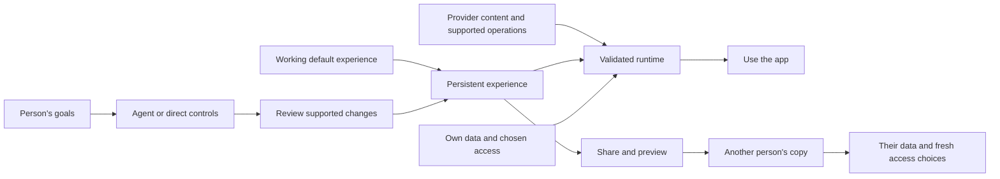

# UDI framework: apps shaped by the people who use them

**English** | [简体中文](zh-CN/FRAMEWORK.md)

**Draft 0.1 · October 17, 2026 · proposal for discussion**

This document defines the general idea, its responsibilities, and a testable implementation target. It is a project draft, not a ratified industry standard. The executable [Core 0.1 specification](SPECIFICATION.md) is a narrower research-workspace profile of this idea. Application version 0.4.0 does not change that schema version.

## 1. Purpose and value

**A User-Defined Interface is a persistent app experience that a person can shape through natural language and direct controls, including its presentation, supported interactions, and the way it organizes and uses permitted data. The experience can be shared for another person to use with their own data and permissions.**

A platform supplies useful content or services, supported operations, resource policy, and a working default app. UDI lets people personalize that app within its supported scope, retain their choices, and reuse compatible experiences made by others. The provider contract determines what the experience can do; each person separately chooses the data and access it may use.

The word *interface* includes the user's working arrangement with the app: which information matters, how it is grouped, what interactions are available, and which supported operations turn intent into results. A theme alone is one small customization; the UDI proposal concerns this broader experience.

### Domain examples

The same framework can support different domains through their respective provider contracts:

| Context | Illustrative user request | Reusable experience | Personal state that stays separate |
| --- | --- | --- | --- |
| Music | “Show the album library and playback queue together.” | Library arrangement, queue view and supported playback controls | Account, library, playback state and grants |
| Reading and study | “Show unfinished reading by topic, with my notes beside it.” | Reading view, grouping rules, note workflow | Documents, annotations, progress and account access |
| Photos | “Build a family-album workspace with a simple review step before sharing.” | Album organization and supported review interaction | Photos, identities, location metadata and publication permissions |
| Travel | “Keep today's plan, tickets, and walking directions together.” | Trip view and supported itinerary operations | Bookings, location, identity and service credentials |
| Research | “Put failed runs first and let me review a summary note.” | Views, filters, provenance interaction and note action | Records, local notes, source bindings and grants |

These examples describe possible applications. Only the bounded research profile is implemented here. No music, photo, booking, or document-service integration is implied.

## 2. Five responsibilities

1. **Provider / host:** supplies useful content or services, supported operations, resource policy, and a working default experience. Integration may be native to an app or through an adapter. A public API is not required for the end user; authorized host integration is still needed underneath.
2. **Person:** chooses goals and preferences, reviews material changes, selects data access, uses the app, and decides what to share.
3. **Agent and direct controls:** translate user choices into supported revisions. Both author the same persistent experience. Chat does not replace every button or require another model call for ordinary use.
4. **Runtime:** validates revisions, renders approved components, resolves personal data, checks authority, and executes supported operations.
5. **Sharing and discovery:** let people preview, adopt, personalize, and redistribute compatible experiences. Direct links and a community gallery are complementary routes; community listing is not required for direct sharing.

## 3. Experience, provider contract, and personal instance

A **reusable experience** describes presentation, interaction rules, permitted data transformations or selection rules, and references to supported actions. Its underlying serialization is an implementation detail for ordinary users. Exporting JSON is a developer tool, not the definition of UDI.

A **provider contract** defines the data types, components, operations, supported versions, and limits that a runtime understands. Reading records, creating a private result, and publishing content are distinct operations with distinct authority requirements. A request cannot invent a missing operation or turn read access into write access.

A **personal instance** supplies concrete accounts, resource bindings, records, saved results, credentials, grants, and activity. The same experience may operate over two instances with different data. A compatible experience does not transfer a provider subscription or content license.

Conceptually, let `E` be the experience, `C` the provider contract, and `I` the personal instance. The runtime computes `R(E, C, I)` only when `E` is supported by `C` and the requested use is allowed for `I`. Sharing carries `E` and its compatibility requirements; it does not implicitly copy `I`.

Selection rules can be reusable; selected records remain personal data. For example, grouping unread documents by topic can be a shared rule without including the author's documents or reading history. Sharing actual content requires a separate provider-supported operation, with its own review and authorization.

## 4. Proposed requirements

**MUST**, **SHOULD**, and **MAY** express requirements within this draft. They are a target for implementations claiming this framework, not a claim that every requirement is implemented in this repository.

| ID | Requirement |
| --- | --- |
| UDI-01 | A host MUST supply a usable default experience. Ordinary use, supported personalization, and direct sharing MUST NOT require the user to program, obtain developer credentials, edit a schema, or upload a definition file. Advanced tools MAY remain available. |
| UDI-02 | Personalization MUST persist beyond the authoring conversation. The host MUST identify the supported scope of presentation, interaction, information handling, and actions; unsupported requests MUST fail visibly. |
| UDI-03 | An agent-enabled implementation MUST offer natural-language authoring and direct controls over its declared personalization scope. Material changes MUST have an understandable review or an explicitly chosen, bounded auto-apply policy. Normal runtime interactions MAY execute without another authoring review. |
| UDI-04 | The runtime MUST validate definitions and reject unknown versions, invalid references, unsupported operations, and executable content outside its declared execution policy. Stale proposals MUST NOT silently overwrite newer state. |
| UDI-05 | A reusable experience MUST be separate from personal records, credentials, concrete resource bindings, grants, chat, and activity. A share action MUST identify what travels and let the author review public text. Explicit content sharing MUST be a separate supported action. |
| UDI-06 | A recipient MUST be able to preview and deliberately adopt a compatible experience. Opening a link MUST NOT itself replace the current experience, grant access, or execute effects. Previews MUST identify sample content and any private data they would use. |
| UDI-07 | Adoption MUST preserve the recipient's records and establish recipient-specific bindings and access choices. An experience MUST NOT confer authority by requesting it. Fresh adoption in this prototype clears local grants. |
| UDI-08 | Every data access and effect MUST remain subject to host policy and resource scope. Production implementations MUST enforce this at a trusted boundary; browser state or model assertions alone are insufficient. Sensitive effects MUST show the exact operation and require authorization appropriate to its risk. |
| UDI-09 | Users MUST have an understandable path to revise or restore their experience and revoke access. Restoring a definition MUST NOT imply reversal of already executed effects. Hosts SHOULD supply accessible, localized controls and explain storage/backup limits. |
| UDI-10 | A portability claim MUST name the experience format/version, provider contract, component and action vocabulary, and receiving implementation that were tested. Missing support MUST be reported before adoption. Cross-provider reuse MUST NOT be presumed from a shared label. |

An implementation should publish the scope of each claim and evidence for it. A natural-language authoring surface alone does not establish model quality; a local browser permission demonstration does not establish production authorization.

## 5. Everyday lifecycle

**Start → use → describe or adjust → review → keep using → share → preview → adopt → personalize.**

For a recipient, the simple path is: open a link or gallery card, see what the experience does, choose **Use**, choose their workspace or account and access, then use it. Technical files, capability identifiers, and publication mechanics belong in advanced tools. A platform can supply account and consent screens without asking a person to configure an API.

The agent can help organize information and prepare supported operations. It need not remain in control of every interaction after authoring. The app should remain usable through its ordinary controls when the conversation ends.

## 6. Profiles and compatibility

UDI is a framework with domain-specific profiles, not a universal data schema. A profile must document entity schemas, query/transform semantics, components, supported actions, error behavior, versioning, and authority checks. Automatic background workflows additionally need trigger, execution, cancellation, retry, and consent semantics; they are future work here.

The current **Core 0.1 research profile** defines experiments, commits, papers, deadlines, five component types, bounded filtering/grouping/layout revisions, and one confirmed local-note action. Its [JSON Schema](../spec/udi.schema.json), [specification](SPECIFICATION.md), fixtures, and tests are executable. It has no general workflow language or other domain-specific provider contracts. Naming this scope does not introduce a new field into existing packages.

A receiving implementation must check actual versions and capabilities. An experience intended for one host may be reusable on another only after a tested adapter maps the relevant contract and operations. Responsive desktop/phone presentations and rebinding datasets inside this repository demonstrate one runtime; independent interoperability remains unproven.

## 7. Evidence in this repository

| Area | Current evidence | Remaining limit |
| --- | --- | --- |
| Ordinary use and persistence | Desktop/phone defaults; chat and controls; reviewed changes, undo and browser persistence | Hosted authoring is a bounded command parser; optional model bridge is for local development |
| Simple adoption and sharing | Visual sample previews; explicit Use; native Share or Copy link; fresh grants; private-state preservation tests | No hosted short-link service, account sync, or direct-link revocation service |
| Personal information handling | Workspace-entry form, per-instance read choices, supported filters/grouping and confirmed notes | Research data only; no live provider accounts or general workflows |
| Validated definitions | Strict Core 0.1 schema, semantic checks, stale-review rejection and share-link tests | No universal contract negotiation or independently implemented receiver |
| Authority | Request/grant separation, scoped local checks and exact-note confirmation | In-browser demonstration, not a production resource gateway |
| Discovery | Labeled project examples and validated GitHub community posts when available | GitHub listing is an advanced path; no demonstrated community adoption or mature moderation |

See [evaluation](EVALUATION.md) for reproducible checks, study proposals, and limits; [security](../SECURITY.md) for the threat model. A future implementation should report task success, revision reliability, time to useful adoption, permission comprehension, and instance-state leakage, alongside model and runtime costs.

## 8. Relationship to existing work

This framework can be implemented using established UI and agent infrastructure. [A2UI](https://a2ui.org/introduction/what-is-a2ui/) describes declarative agent-driven interfaces; [AG-UI](https://docs.ag-ui.com/introduction) describes agent–application interaction events; [MCP Apps](https://apps.extensions.modelcontextprotocol.io/api/documents/overview.html) supplies interactive tool UI resources embedded by hosts. UDI's proposed evaluation target is the sustained user lifecycle across authoring, ordinary use, personal data control, and experience reuse. These projects may implement that lifecycle too. No adapter compatibility or comparative superiority is claimed here.

The phrase “user-defined interface” and acronym UDI also have prior use; this project does not claim to coin them. See [related work](RELATED-WORK.md) for attribution and the limits of the novelty claim.
