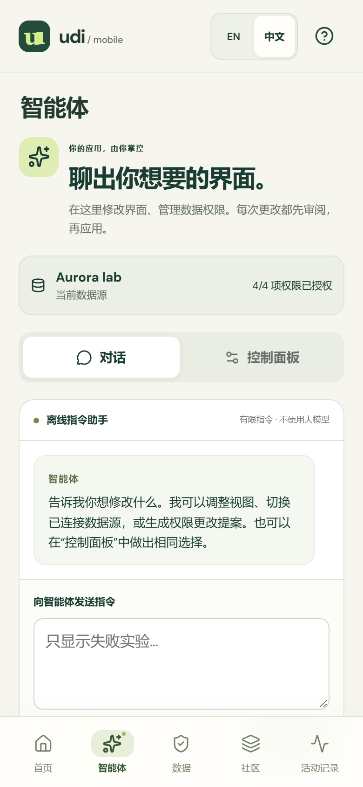

# 智能体对话、控制面板与可选本地模型规划器

[English](../AGENT.md) | **简体中文**

默认演示无需模型即可运行。这个可选的开发桥接服务允许本地安装的 Ollama 模型将自然语言编辑请求转换为同一组范围受限的操作。

## 智能体与控制面板



桌面与手机均提供**智能体**标签。**对话**在本地保留最近 40 条消息，并为支持范围内的中文、英文指令生成待审阅的更改。**控制面板**以设置式布局提供布局、实验筛选、视图显示、已连接数据源和能力授权控件。两者使用同一控制器与精确状态检查，只有点击**应用更改**才会执行。

示例：`切换到 Atlas lab`、`撤销实验访问权限`、`授予实验访问权限` 和 `只显示失败实验`。绑定指令也可使用导入数据源的名称或 ID。授权属于各实例，授予 `notes.write` 后仍需另行确认具体笔记内容才会写入。撤销仅恢复界面定义，并保留当前绑定、授权和笔记。不支持的请求不会修改状态，可在面板中清除本地对话。托管模式明确标为**离线指令助手**，不使用大模型。

## 运行可选模型桥接

安装并启动 [Ollama](https://docs.ollama.com/)，然后安装一个支持结构化 JSON 输出的模型，并记录它在本地的精确名称。模型选择取决于硬件；本项目不附带或推荐某个特定模型。

在一个终端中，将 `UDI_OLLAMA_MODEL` 设置为已安装模型的名称，然后运行：

```sh
npm run agent
```

PowerShell 示例，将引号中的名称替换为已安装的模型：

```powershell
$env:UDI_OLLAMA_MODEL = 'your-installed-model-name'
npm run agent
```

在另一个终端中运行：

```sh
npm run dev -- --port 4178
```

在意图输入区的规划器选择器中选择 **Local model · Ollama**。桥接服务仅监听 `127.0.0.1:4179`；Vite 将 `/api/plan` 代理到该服务。Ollama 应运行在 `127.0.0.1:11434`。静态生产构建只提供离线规划器，因为它没有本地代理或托管模型服务。

## 契约

浏览器 → 桥接服务：`{ intent, spec, revision }`。不接受数据集、笔记、授权、凭据或实例绑定对象。桥接服务在调用模型前验证定义。

桥接服务 → Ollama：使用 `/api/chat`、`stream: false`、在 `format` 中提供规划器输出 Schema，并限制输出长度、使用较低温度。这遵循 [Ollama 的结构化输出接口](https://docs.ollama.com/capabilities/structured-outputs)。

模型 → 桥接服务：`{ summary, operations }`。宿主拒绝未知字段和操作，计算新增能力，模拟候选结果，并验证生成的定义。空操作列表表示不受支持的请求，界面会将模型解释作为错误展示。浏览器还会基于原始基准定义，再次验证返回的操作文档。

通过此接口，任何模型输出都不能执行处理器、授予访问权限、读取演示记录、提供 URL，或绕过用户对变更的审查。即使提案有效，也仍可能不符合用户意图。

## 验证状态

单元测试通过注入的模拟传输，覆盖格式错误的模型输出、语义失败、新增能力、请求最小化和失败传播。浏览器测试也使用基于固定测试数据的 HTTP 响应覆盖模型模式。

2026 年 10 月 17 日，使用本地安装的 `qwen3.5:9b-q8_0` 模型和 Ollama 0.40.4，通过了两个直接冒烟测试用例，以及一个“浏览器 → 代理 → 桥接服务 → 模型 → 审查 → 渲染”场景。参见[原始冒烟测试输出](../model-smoke-results.json)、[浏览器集成记录](../bridge-smoke-results.json)，以及[开发失败与观察](MODEL-OBSERVATIONS.md)。生成请求显式关闭思考并限制输出。记录的时间只描述这些调用；没有测量推理使用的设备。本项目不声称已完成广泛的质量基准测试或多轮研究。

设置环境变量后，运行 `npm run smoke:model` 可重复两个直接冒烟测试。要重复浏览器集成，启动两个服务后运行 `npx tsx scripts/capture-model-demo.ts`（Windows 上设置 `PLAYWRIGHT_CHANNEL=msedge` 可使用已安装的 Edge）。

评估真实模型时，应记录精确模型标识和摘要、Ollama 版本、硬件、提示词与 Schema 版本、每次请求和输出、Schema 通过情况、任务语义成功情况、拒绝行为、延迟和人工修正率。离线符合性用例不足以证明语言模型的表现。
