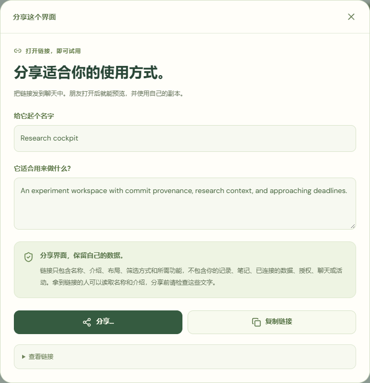

# 界面社区与个人数据

[English](../COMMUNITY.md) | **简体中文**

[打开演示](https://deepbule0.github.io/UDI/?lang=zh-CN) · [手机演示](https://deepbule0.github.io/UDI/mobile.html?lang=zh-CN) · [公开 GitHub 帖子](https://github.com/deepbule0/UDI/issues?q=is%3Aissue%20is%3Aopen%20label%3Audi-interface)

UDI 让人们分享一种可复用的应用使用方式，包括呈现形式、受支持的行为和数据组织方式。接收者使用自己的工作空间和权限。日常流程是**试用 → 使用 → 个性化 → 分享**，无需准备 API 请求、上传定义文件或阅读 JSON。[通用 UDI 框架](FRAMEWORK.md)面向不同应用类别；当前演示实现的是范围较窄的研究工作空间配置 UDI Core 0.1。

## 用链接分享给任何人

1. 在工作空间选择**分享这个界面**，或在社区选择**分享我的界面**。
2. 填写名称和简短介绍，检查这些公开文字以及通俗的隐私说明。
3. 浏览器支持时选择**分享…**调用系统分享，也可以**复制链接**后粘贴到聊天中。无需 UDI 或 GitHub 账户，也无需文件或上传。
4. 接收者打开链接，会看到使用内置虚构示例数据的可视预览。仅打开链接不会修改其界面或权限。
5. 点击**使用这个界面**后，应用才会创建本地副本、替换当前定义并打开数据页面。所有本地实例的已有授权会清除；接收者选择自己的工作空间，再明确允许所需读取。其记录和笔记仍保留在本地。

链接携带经过校验的定义，包括受支持的筛选、组织方式、操作定义和能力请求，不包含记录、绑定、凭据、授权、笔记、聊天或活动。拿到链接的人能读取名称和描述，请先检查自由文本。链接是副本，不会订阅后续更改；分享链接**不会**自动新增公开社区条目。当前没有托管短链接服务或链接撤销功能，删除帖子也无法收回已发送的链接。部分聊天应用可能截断或拒绝过长链接；高级工具仍提供文件迁移。

## 发现并采用界面

1. 在桌面或手机演示中打开**社区**。按标题、作者或描述搜索，并选择**社区帖子**或**项目示例**筛选。
2. 选择**试试这个界面**。卡片和完整预览会用公共示例数据渲染实际定义。查看受支持的视图以及通俗的数据需求说明；**技术详情**是可选项。
3. 选择**使用这个界面**或**复制并使用**。后者还会创建新的本地界面包 ID 和标题，之后可以继续修改。
4. 安装会替换当前定义，并清除**所有**本地数据集的授权；记录和本地笔记会保留。请在**数据**中重新审阅当前数据源的权限，或在**智能体**中提出权限更改。
5. 打开**智能体 → 对话**，发送支持的指令；也可使用**控制面板**调整布局、筛选、面板显示、数据源和权限。两种智能体模式都会先生成提案，再由你点击**应用更改**。添加写入操作只会声明能力请求，不会自动授权或执行写入；创建具体笔记仍需另行确认。

真实动态读取本仓库带有 `udi-interface` 标签的最多 **50 条开放 GitHub Issues**。只有包含约定标记及单个通过 Schema 校验的 JSON 界面包的帖子会显示，公开作者由 GitHub 账户标识。Pull Request、无效界面包、不支持的字段和可执行组件会被拒绝。这是基于 GitHub 的社区原型，尚无评分、关注关系、私人市场，也不支持任意应用定义。

内置卡片明确标注为 **UDI 项目示例**，由项目作者提供，供体验完整流程使用，不代表其他用户已经发帖。成功获取但为空时，动态会说明目前没有有效界面帖子。获取失败时会标记缓存内容或提示动态不可用，不会虚构社区活动。GitHub 限流和网络错误会影响更新；公开动态缓存仅保存通过校验的公开定义，不读取私人实例状态。

## 公开列出自己的界面：高级发布

1. 在**社区**展开**高级发布**，选择**发布到公开社区**，编辑帖子标题和简介。这个可选的 GitHub 流程与日常链接分享分开。
2. 检查**完整界面包 JSON**。记录、绑定、授权、本地笔记、对话和活动会在结构上排除，但名称、描述等自由文本仍可能包含你输入的私人信息，需要自行检查。
3. 确认内容将在公开平台发布，再选择**打开 GitHub 编辑器**。这会打开本仓库真实的 Issue 模板，**只打开页面不会发布**。
4. 如 GitHub 要求，请先登录，检查 Issue 正文后在 GitHub 提交。较长的定义无法可靠地放入编辑器链接，此时请使用**复制帖子正文**或手动复制，并将完整正文粘贴到 GitHub Issue 描述中再提交。
5. 返回社区并点击**刷新社区**。帖子只有在成功公开获取且通过校验后才会显示。若未出现，请检查它是否为带 `udi-interface` 标签的开放 Issue，包含 `<!-- udi-interface:0.1 -->` 标记，以及恰好一个包含受支持界面包的 `json` 代码围栏。

应用不会索取或保存 GitHub Token。浏览使用公开、无需登录的读取；GitHub 处理登录和最终公开写入。公开分享会展示帖子内容与 GitHub 身份。编辑或撤回帖子需要前往 GitHub；在下次成功刷新前，缓存副本可能仍可见。标签只用于发现内容，不构成安全背书。

## 使用自己的数据

在**数据**中选择**创建我的工作空间**，填写工作空间名称，以及一条实验的名称、模型、状态和分数。点击**创建工作空间**，再选择**允许读取此工作空间**或逐项设置权限。表单会为你准备符合要求的研究记录，无需 JSON 文件。创建笔记仍需单独授权并确认具体操作。这个首次录入表单尚不是完整的研究记录编辑器。

**体验示例**提供包含内置虚构记录的 Aurora 和 Atlas；**我的工作空间**包含仅保存在此浏览器中的个人内容。它们没有连接真实提供方账户。同一界面可以使用不同来源，各自保留独立授权和笔记。

已有标准化记录时，可展开**高级数据工具**使用文件导入和备份。这些是开发与迁移工具，不是日常分享流程。

先选择**下载 JSON 示例**并替换内容，再点击**导入个人数据**，选择文件或粘贴 JSON。标准化结构必须准确包含顶层字段 `id`、`name`、`project`、`description`、`experiments`、`commits`、`deadlines` 和 `papers`。每条实验通过 `commitId` 引用已存在的提交。下载示例展示各类记录的所有必填字段。已实现的研究数据适配器不支持任意应用数据、音频、音乐流、实时 API、凭据、URL 或可执行内容。音乐是一个说明性应用场景，当前未实现音乐服务集成。

导入限制为**每个文件 500 KiB**、**每类 200 条记录**、**5 个个人数据集**，并检查字段长度、唯一 ID、真实日期、有限数值、允许的状态和提交引用。每次导入都会获得新的 `personal-*` ID，不会覆盖 Aurora、Atlas 或其他导入数据。连接时授权为空，需要先审阅权限，界面才能读取记录或创建笔记。绑定和授权属于各自的本地实例；切换数据集会保留它们各自的权限和笔记。

在**高级数据工具 → 保存工作空间备份**中，点击工作空间的下载按钮可获得记录的 JSON 副本，不包含授权或笔记。**删除工作空间**会要求确认，并说明记录、笔记和授权将从此浏览器永久删除；删除当前数据源后会切回 Aurora。分享界面不是备份个人记录。数据不会上传或同步；浏览器清理或存储压力可能删除本地内容，请下载副本保留重要记录。

托管版智能体使用有限的中英文指令语法，不是通用大语言模型。例如，**切换到 Atlas lab**、**撤销实验访问权限**和**授予实验访问权限**会提出实例更改；**只显示失败实验**会提出界面定义更改。绑定指令也可使用已导入数据源的名称。智能体不能自主发布或删除数据。另见[智能体指南](AGENT.md)、[手机指南](MOBILE.md)、[界面包规范](SPECIFICATION.md)和[安全模型](SECURITY.md)。
