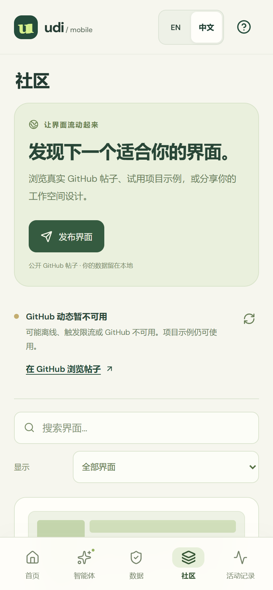

# 界面社区与个人数据

[English](../COMMUNITY.md) | **简体中文**

[打开演示](https://deepbule0.github.io/UDI/?lang=zh-CN) · [手机演示](https://deepbule0.github.io/UDI/mobile.html?lang=zh-CN) · [公开 GitHub 帖子](https://github.com/deepbule0/UDI/issues?q=is%3Aissue%20is%3Aopen%20label%3Audi-interface)

UDI 将可复用的界面定义与每个人实例中的数据和权限分开。**社区**、**智能体**和**数据**页面让这一流程可以实际操作：复制定义，连接自己的记录，然后通过对话或常规控件继续调整。

## 发现并采用界面

1. 在桌面或手机演示中打开**社区**。按标题、作者或描述搜索，并选择**社区帖子**或**项目示例**筛选。
2. 选择**预览并安装**，检查可见视图、能力请求和完整界面包 JSON。卡片缩略图是用于说明布局的图案，具体界面内容以包详情为准。
3. 确认安装范围，再选择**安装界面**或**分支并安装**。分支会获得本地界面包 ID 和标题，之后可以继续修改。
4. 安装会替换当前定义，并清除**所有**本地数据集的授权；记录和本地笔记会保留。请在**数据**中重新审阅当前数据源的权限，或在**智能体**中提出权限更改。
5. 打开**智能体 → 对话**，发送支持的指令；也可使用**控制面板**调整布局、筛选、面板显示、数据源和权限。两种智能体模式都会先生成提案，再由你点击**应用更改**。添加写入操作只会声明能力请求，不会自动授权或执行写入；创建具体笔记仍需另行确认。

真实动态读取本仓库带有 `udi-interface` 标签的最多 **50 条开放 GitHub Issues**。只有包含约定标记及单个通过 Schema 校验的 JSON 界面包的帖子会显示，公开作者由 GitHub 账户标识。Pull Request、无效界面包、不支持的字段和可执行组件会被拒绝。这是基于 GitHub 的社区原型，尚无评分、关注关系、私人市场，也不支持任意应用定义。

内置卡片明确标注为 **UDI 项目示例**，由项目作者提供，供体验完整流程使用，不代表其他用户已经发帖。成功获取但为空时，动态会说明目前没有有效界面帖子。获取失败时会标记缓存内容或提示动态不可用，不会虚构社区活动。GitHub 限流和网络错误会影响更新；公开动态缓存仅保存通过校验的公开定义，不读取私人实例状态。

## 发布自己的界面

1. 在**社区**中选择**发布界面**，编辑帖子标题和简介。
2. 检查**完整界面包 JSON**。记录、绑定、授权、本地笔记、对话和活动会在结构上排除，但名称、描述等自由文本仍可能包含你输入的私人信息，需要自行检查。
3. 确认内容将在公开平台发布，再选择**打开 GitHub 编辑器**。这会打开本仓库真实的 Issue 模板，**只打开页面不会发布**。
4. 如 GitHub 要求，请先登录，检查 Issue 正文后在 GitHub 提交。较长的定义无法可靠地放入编辑器链接，此时请使用**复制帖子正文**或手动复制，并将完整正文粘贴到 GitHub Issue 描述中再提交。
5. 返回社区并点击**刷新社区**。帖子只有在成功公开获取且通过校验后才会显示。若未出现，请检查它是否为带 `udi-interface` 标签的开放 Issue，包含 `<!-- udi-interface:0.1 -->` 标记，以及恰好一个包含受支持界面包的 `json` 代码围栏。

应用不会索取或保存 GitHub Token。浏览使用公开、无需登录的读取；GitHub 处理登录和最终公开写入。公开分享会展示帖子内容与 GitHub 身份。编辑或撤回帖子需要前往 GitHub；在下次成功刷新前，缓存副本可能仍可见。标签只用于发现内容，不构成安全背书。

## 使用自己的数据

**数据**页面区分**平台示例**与**个人数据 · 仅限此浏览器**。Aurora 和 Atlas 是内置虚构记录，没有连接真实的平台账户数据。导入个人 JSON 后，可以让同一个研究界面读取你提供的记录。

先选择**下载 JSON 示例**并替换内容，再点击**导入个人数据**，选择文件或粘贴 JSON。标准化结构必须准确包含顶层字段 `id`、`name`、`project`、`description`、`experiments`、`commits`、`deadlines` 和 `papers`。每条实验通过 `commitId` 引用已存在的提交。下载示例展示各类记录的所有必填字段。这是研究数据适配器，不支持音频、音乐流、任意文件、实时 API、凭据、URL 或可执行内容。

导入限制为**每个文件 500 KiB**、**每类 200 条记录**、**5 个个人数据集**，并检查字段长度、唯一 ID、真实日期、有限数值、允许的状态和提交引用。每次导入都会获得新的 `personal-*` ID，不会覆盖 Aurora、Atlas 或其他导入数据。连接时授权为空，需要先审阅权限，界面才能读取记录或创建笔记。绑定和授权属于各自的本地实例；切换数据集会保留它们各自的权限和笔记。

个人数据源的**下载数据**会导出记录的 JSON 副本，不包含授权或笔记。**删除数据**会要求确认，并说明记录、笔记和授权将从此浏览器永久删除；删除当前数据源后会切回 Aurora。界面包不是个人记录的备份。数据不会上传或同步；浏览器清理或存储压力可能删除本地内容，请下载副本保留重要记录。

托管版智能体使用有限的中英文指令语法，不是通用大语言模型。例如，**切换到 Atlas lab**、**撤销实验访问权限**和**授予实验访问权限**会提出实例更改；**只显示失败实验**会提出界面定义更改。绑定指令也可使用已导入数据源的名称。智能体不能自主发布或删除数据。另见[智能体指南](AGENT.md)、[手机指南](MOBILE.md)、[界面包规范](SPECIFICATION.md)和[安全模型](SECURITY.md)。
