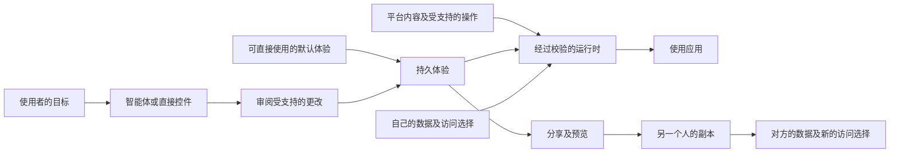

# UDI 框架：让使用者塑造自己的应用

[English](../FRAMEWORK.md) | **简体中文**

**草案 0.1 · 2026 年 10 月 17 日 · 公开讨论提案**

本文定义通用理念、各方职责及可验证的实现目标。这是项目草案，并非已获行业认可的标准。可执行的 [Core 0.1 规范](SPECIFICATION.md) 是其中范围较小的研究工作空间配置。应用版本 0.4.0 不改变该数据格式版本。

## 1. 目的与价值

**用户定义界面（UDI）是一种可持续使用的应用体验：使用者通过自然语言和直接控件，塑造其呈现方式、受支持的交互，以及如何组织和使用已获许可的数据；这种体验可以被分享，让另一个人配合自己的数据与权限使用。**

平台提供有价值的内容或服务、受支持的操作、资源策略，以及可直接使用的默认应用。UDI 让用户在支持范围内个性化应用、保留自己的选择，并复用他人制作的兼容体验。平台契约决定体验能够做什么；每个人分别选择体验可以使用的数据及权限。

这里的“界面”包含人与应用之间的使用方式：哪些信息重要、如何组织、提供哪些交互，以及哪些受支持的操作能够实现目标。主题换肤是一种局部定制；UDI 讨论的是更完整的应用体验。

### 领域示例

同一框架可以通过各自的平台契约支持不同领域：

| 场景 | 示例需求 | 可复用的体验 | 分开保留的个人状态 |
| --- | --- | --- | --- |
| 音乐 | “把专辑库和播放队列放在一起。” | 音乐库布局、队列视图与受支持的播放控件 | 账户、音乐库、播放状态及授权 |
| 阅读与学习 | “按主题显示没读完的内容，把笔记放在旁边。” | 阅读视图、分组规则、笔记流程 | 文档、批注、进度与账户权限 |
| 照片 | “建立家庭相册工作空间，分享前有一个简单的审阅步骤。” | 相册组织方式与受支持的审阅交互 | 照片、身份、位置元数据与发布权限 |
| 出行 | “把今天的计划、票据和步行路线放在一起。” | 行程视图与受支持的计划操作 | 订单、位置、身份与服务凭据 |
| 研究 | “先显示失败实验，让我审阅一份汇总笔记。” | 视图、筛选、溯源交互与笔记操作 | 记录、本地笔记、数据源绑定及授权 |

这些是可能的应用场景。当前仅实现有限的研究配置，没有实现音乐、照片、订票或文档服务集成。

## 2. 五类职责

1. **平台／宿主：** 提供有价值的内容或服务、受支持的操作、资源策略及可直接使用的默认体验。集成可以原生内置于应用，也可以通过适配器完成。使用者无需获得公开 API，底层仍需要经过授权的宿主集成。
2. **使用者：** 选择目标与偏好、审阅重要更改、决定数据访问、使用应用，并选择分享什么。
3. **智能体与直接控件：** 把人的选择转成受支持的修订，共同修改同一份持久体验。对话不必替代所有按钮，日常操作也不必再次调用模型。
4. **运行时：** 校验修订、渲染批准的组件、解析个人数据、检查权限并执行受支持的操作。
5. **分享与发现：** 支持预览、采用、个性化及再分享兼容的体验。直接链接与社区画廊互为补充，不公开上架也能直接分享。

## 3. 体验、平台契约与个人实例

**可复用体验**描述呈现方式、交互规则、允许的数据转换或选择规则，以及对受支持操作的引用。底层序列化格式是普通使用者无需处理的实现细节。导出 JSON 属于开发工具，不是 UDI 的定义。

**平台契约**定义运行时理解的数据类型、组件、操作、版本与限制。读取记录、创建私人结果与公开内容是不同的操作，具有不同的授权要求。一个请求不能凭空创造平台不具备的操作，也不能把读取权限变成写入权限。

**个人实例**提供具体账户、资源绑定、记录、保存的结果、凭据、授权与活动。同一体验可以在不同数据的两个实例中运行。兼容体验不会转移平台会员或内容许可。

概念上，以 `E` 表示体验、`C` 表示平台契约、`I` 表示个人实例。仅在 `C` 支持 `E`，且 `I` 允许所请求的使用方式时，运行时才计算 `R(E, C, I)`。分享携带 `E` 及其兼容要求，不会默认复制 `I`。

选择规则可以复用，被选中的记录仍属于个人数据。例如，按主题组织未读文档可以成为共享规则，而不包含作者的文档或阅读历史。分享实际内容需要单独的平台支持操作，并有其独立的审阅与授权。

## 4. 拟议要求

下表中的**必须（MUST）**、**应该（SHOULD）**和**可以（MAY）**表示本草案内部的要求。这是声称实现本框架时的目标，不表示仓库已经实现所有要求。

| 编号 | 要求 |
| --- | --- |
| UDI-01 | 宿主必须提供可直接使用的默认体验。日常使用、受支持的个性化和直接分享不得要求使用者编程、获得开发者凭据、编辑 Schema 或上传定义文件。可以保留高级工具。 |
| UDI-02 | 个性化结果必须在创作对话结束后持续存在。宿主必须说明呈现、交互、信息处理与操作的支持范围；不支持的请求必须明确失败。 |
| UDI-03 | 支持智能体的实现必须同时提供自然语言创作和覆盖其声明的个性化范围的直接控件。重要更改必须有易理解的审阅，或使用者明确选择的有限自动应用策略。普通运行时交互可以不重复经过创作审阅。 |
| UDI-04 | 运行时必须校验定义，拒绝未知版本、无效引用、不支持的操作及超出声明执行策略的可执行内容。过期提案不得静默覆盖较新状态。 |
| UDI-05 | 可复用体验必须与个人记录、凭据、具体资源绑定、授权、聊天及活动分开。分享必须说明携带内容，并让作者审阅公开文字。明确分享内容必须属于单独的受支持操作。 |
| UDI-06 | 接收者必须能够预览并主动采用兼容体验。打开链接本身不得替换当前体验、授予权限或执行副作用。预览必须说明示例内容以及可能使用的私人数据。 |
| UDI-07 | 采用体验必须保留接收者的记录，并建立属于接收者的绑定及访问选择。请求权限不得等同于获得权限。本原型采用新体验时清空本地授权。 |
| UDI-08 | 每次数据访问与副作用必须服从宿主策略和资源范围。生产实现必须在可信边界上执行检查，仅凭浏览器状态或模型声明不足以提供保护。敏感操作必须展示具体内容，并采用与风险相适应的授权方式。 |
| UDI-09 | 使用者必须有易理解的路径来修订或恢复体验、撤销访问。恢复定义不得暗示撤销已经发生的副作用。宿主应该提供无障碍、本地化控件，并说明存储与备份限制。 |
| UDI-10 | 可移植性声明必须列明实际测试过的体验格式与版本、平台契约、组件及操作词汇、接收实现。采用之前必须报告缺失支持。不得仅凭共同名称推定跨平台复用。 |

实现应公布每项声明的范围与证据。自然语言创作入口本身不能证明模型质量，本地浏览器权限演示也不能证明生产授权安全。

## 5. 日常使用过程

**开始 → 使用 → 描述或调整 → 审阅 → 持续使用 → 分享 → 预览 → 采用 → 个性化。**

对接收者而言，简单路径是打开链接或画廊卡片，了解体验的作用，选择**使用**，选择自己的工作空间或账户及权限，然后开始使用。技术文件、能力标识符和发布机制应放在高级工具中。平台可以提供账户及授权页面，无需让使用者配置 API。

智能体可以协助组织信息并准备受支持的操作。创作之后，它不必控制每次交互。对话结束后，用户仍应能通过常规控件继续使用应用。

## 6. 领域配置与兼容性

UDI 是包含不同领域配置的框架，不是通用数据 Schema。一个配置必须说明实体 Schema、查询／转换语义、组件、受支持的操作、错误行为、版本及权限检查。自动后台工作流还需要触发、执行、取消、重试与同意语义，当前尚未实现。

当前的 **Core 0.1 研究配置**定义实验、提交、论文、截止日期、五种组件、有限的筛选／分组／布局修订，以及一种需要确认的本地笔记操作。其 [JSON Schema](../../spec/udi.schema.json)、[规范](SPECIFICATION.md)、示例数据与测试可执行。它没有通用工作流语言或其他领域的平台契约。明确这一范围不会在现有界面包中新增字段。

接收实现必须检查实际版本与能力。一个宿主的体验，只有经过测试的适配器映射了相关契约和操作，才可能在另一个宿主复用。本仓库的桌面／手机呈现与数据集切换展示的是同一个运行时；独立实现之间的互操作尚未证明。

## 7. 本仓库中的证据

| 方面 | 当前证据 | 尚存限制 |
| --- | --- | --- |
| 日常使用与持久性 | 桌面／手机默认界面、对话与控件、审阅修订、撤销及浏览器持久化 | 托管创作使用有限指令解析器，可选模型桥接仅用于本地开发 |
| 简单采用与分享 | 示例数据视觉预览、主动使用、系统分享或复制链接、新授权、私人状态保留测试 | 没有托管短链接、账户同步或直接链接撤回服务 |
| 个人信息处理 | 工作空间录入表单、每实例读取选择、筛选分组及确认后的笔记 | 仅研究数据，没有真实平台账户或通用工作流 |
| 定义校验 | 严格 Core 0.1 Schema、语义检查、过期审阅拒绝及分享链接测试 | 没有通用契约协商或独立接收实现 |
| 权限 | 请求与授权分离、限定范围的本地检查及具体笔记确认 | 是浏览器内演示，不是生产资源网关 |
| 发现 | 明确标注的项目示例，以及可用时经过校验的 GitHub 社区帖子 | GitHub 上架属于高级路径，没有已证实的社区采用或成熟审核体系 |

可复现检查、用户研究方案及限制见[评估](EVALUATION.md)，威胁模型见[安全说明](SECURITY.md)。未来实现应报告任务成功率、修订可靠性、达到可用体验所需时间、权限理解和实例状态泄露，并同时报告模型及运行成本。

## 8. 与现有工作的关系

本框架可以采用已有界面与智能体基础设施。[A2UI](https://a2ui.org/introduction/what-is-a2ui/) 描述声明式智能体界面，[AG-UI](https://docs.ag-ui.com/introduction) 描述智能体与应用之间的交互事件，[MCP Apps](https://apps.extensions.modelcontextprotocol.io/api/documents/overview.html) 提供由宿主嵌入的交互式工具界面资源。UDI 提议评估的是创作、日常使用、个人数据控制及体验复用这一持续过程。这些项目也可以实现该过程。本仓库不声称适配器兼容或比较优势。

“用户定义界面”及 UDI 缩写已有历史用法，本项目不声称创造这个名称。来源与新颖性声明的限制见[相关工作](RELATED-WORK.md)。
